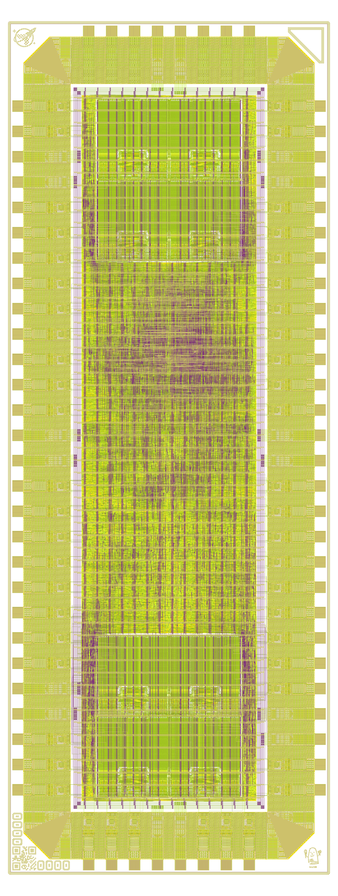
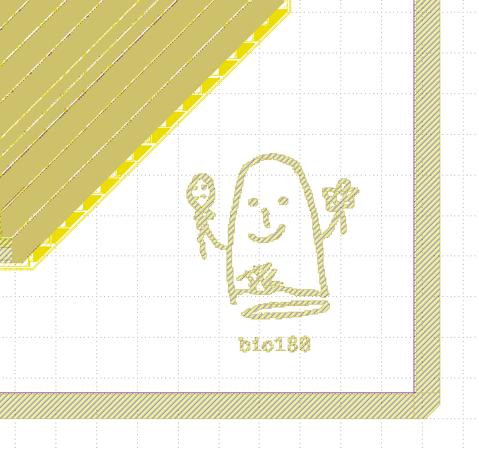

# BIO-Core — GF180MCU
# bio180


A dual-core programmable I/O coprocessor ported from [bunnie Huang's BIO](https://github.com/betrusted-io/betrusted-soc) (Betrusted I/O) to the GlobalFoundries GF180MCU 180nm process, targeting [wafer.space](https://wafer.space) Run 2.

Each core is a PicoRV32 RISC-V (RV32I) processor with 2 KiB SRAM (8× GF180MCU foundry SRAM macros), clock-gated for FIFO blocking and event wait. The host interface is SPI with burst IMEM loading and full 9-bit addressing.


## CHIP

<div align="center">
  
</div>

## Chip Art 

A ghost with flower and balloon in his hands with bio180 written in under it.

<div align="center">
  
</div>

## Architecture

```
                   RP2040 (Host)
                       │ SPI
                       ▼
                 ┌─────────────┐
                 │ SPI Bridge  │
                 └──────┬──────┘
          ┌─────────────┼─────────────┐
          ▼             ▼             ▼
    ┌──────────┐  ┌──────────┐  ┌──────────┐
    │  Core 0  │  │  4×FIFO  │  │  Core 1  │
    │ PicoRV32 │  │  (shared)│  │ PicoRV32 │
    │ 2KB SRAM │  │          │  │ 2KB SRAM │
    └────┬─────┘  └──────────┘  └─────┬────┘
         │     32-bit GPIO (bidir)    │
         └────────────┬───────────────┘
                      ▼
              Physical Pins (32)
```

## Key Features

- **Dual PicoRV32 cores** — RV32I, independently programmable, clock-gated
- **2 KiB IMEM per core** — 8× `gf180mcu_fd_ip_sram__sram512x8m8wm1` macros
- **32 bidirectional GPIO** — split across EAST (0–18) and WEST (19–31) pads
- **4 shared FIFOs** — inter-core and host↔core communication
- **SPI slave interface** — register access, burst IMEM write with auto-increment

## Slot & Process

| Parameter | Value |
|-----------|-------|
| Process | GlobalFoundries GF180MCU (180nm, 5V) |
| Slot | 0.5×1 (1936 × 5122 µm) |
| Standard cells | `gf180mcu_fd_sc_mcu7t5v0` |
| SRAM | `gf180mcu_fd_ip_sram__sram512x8m8wm1` × 8 |
| IO pads | `gf180mcu_fd_io` (5V tolerant) |
| Target clock | 10 MHz |
| Shuttle | wafer.space Run 2 |

## Pin Map

```
              ┌────── NORTH ──────┐
              │  analog (unused)  │
   ┌──────────┤                   ├──────────┐
   │ GPIO[31] │                   │ SPI MISO │
   │ GPIO[30] │                   │ IRQ[0]   │
   │    ...   │                   │ IRQ[1]   │
W  │ GPIO[19] │    BIO-Coprocessor│ GPIO[0]  │ E
E  │          │                   │   ...    │ A
S  │ (unused) │                   │ GPIO[18] │ S
T  │          │                   │          │ T
   │          │                   │ (unused) │
   └──────────┤                   ├──────────┘
              │ CLK RST SCLK     │
              │ MOSI CS_N spare  │
              └────── SOUTH ──────┘
```


## Complete PINOUT 

 [PINOUT](pinout.md)

## SPI Protocol

| Command | Code | Description |
|---------|------|-------------|
| REG_WRITE | 0x02 | Write host register (8-bit addr) |
| REG_READ | 0x03 | Read host register (8-bit addr) |
| IMEM_WRITE_LO | 0x04 | Write IMEM addr 0–255, burst with auto-increment |
| IMEM_READ_LO | 0x05 | Read IMEM addr 0–255 |
| IMEM_WRITE_HI | 0x06 | Write IMEM addr 256–511, burst with auto-increment |
| IMEM_READ_HI | 0x07 | Read IMEM addr 256–511 |

Frame format: `[CMD 8b] [ADDR 8b] [DATA 32b MSB-first]` — 6 bytes per transaction.
IMEM write burst: keep CS low, stream 32-bit words. Address auto-increments across the 256 boundary.

## Register Map

| Address | Name | Description |
|---------|------|-------------|
| 0x00 | CTRL | Core enable + restart bits |
| 0x0C | FIFO_LEVEL | 4×4-bit FIFO fill levels |
| 0x10–0x1C | TXF0–TXF3 | FIFO write (host → core) |
| 0x20–0x2C | RXF0–RXF3 | FIFO read (core → host) |
| 0x48 | FIFO_CLR | FIFO clear bits |
| 0x50 | QDIV0 | Core 0 quantum divider |
| 0x54 | QDIV1 | Core 1 quantum divider |
| 0x64 | OE_INV | Direction inversion mask |
| 0x68 | OUT_INV | Output inversion mask |
| 0x6C | IN_INV | Input inversion mask |
| 0x70 | IRQMASK0 | Core 0 IRQ mask |
| 0x74 | IRQMASK1 | Core 1 IRQ mask |
| 0x84 | GPIO_O | GPIO output readback |
| 0x88 | GPIO_D | GPIO direction readback |
| 0xFC | CHIP_ID | Returns `0x0B100002` |

## Build

This was generated on wafer space [template](https://github.com/wafer-space/gf180mcu-project-template) Version 1.5.7

```bash
# Enter environment
cd gf180mcu && nix-shell

# Run cocotb tests
cd sim/cocotb && MODULE=test_chip_id make

# Run ASIC flow
SLOT=0p5x1 make librelane-nodrc

# Run manufacturing precheck
make precheck
```

## Verification

13 cocotb tests passing across chip ID, FIFO echo, GPIO output, SPI bitbang, events, multi-core quantum sync, and 32-bit GPIO expansion. Gate-level simulation confirms ICG clock gating and dual-core concurrent GPIO operation.

## Gratitude 

Thank you [Bunnie Andrew Huang](https://en.wikipedia.org/wiki/Andrew_Huang_(hacker)) for giving me this opportunity to make this And specially for sponsoring the WS2 shuttle for it 

## Credits

- **BIO architecture** — [bunnie Huang](https://github.com/bunnie) (Betrusted/Precursor SoC)
- **BAO CHIP X1** BaoChip1x(https://github.com/baochip/baochip-1x)
- **ASIC port** — Deepak ([@dpks2003](https://github.com/dpks2003))


## License

Apache-2.0
